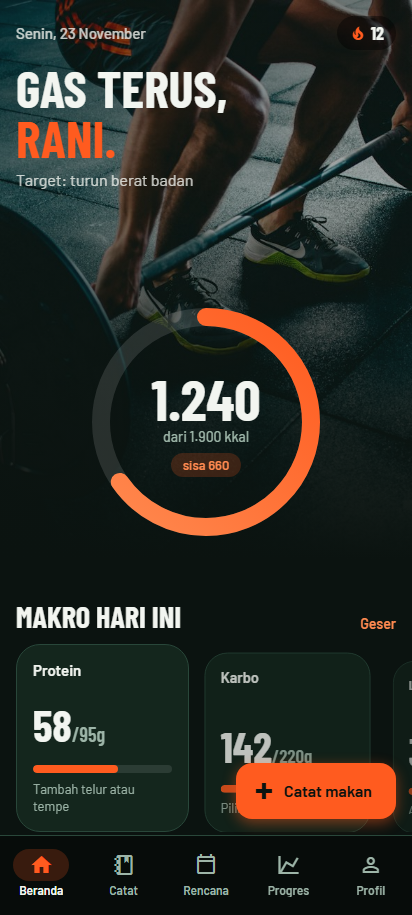
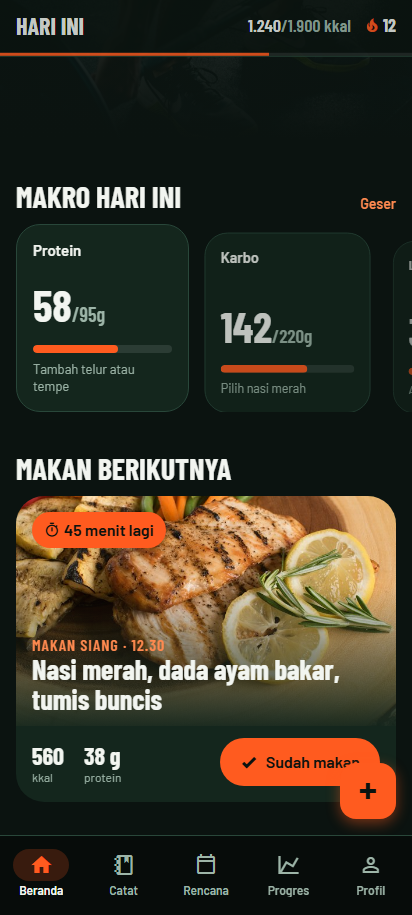
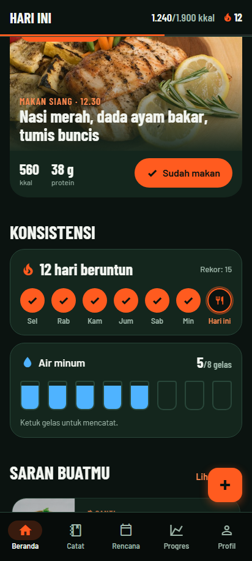
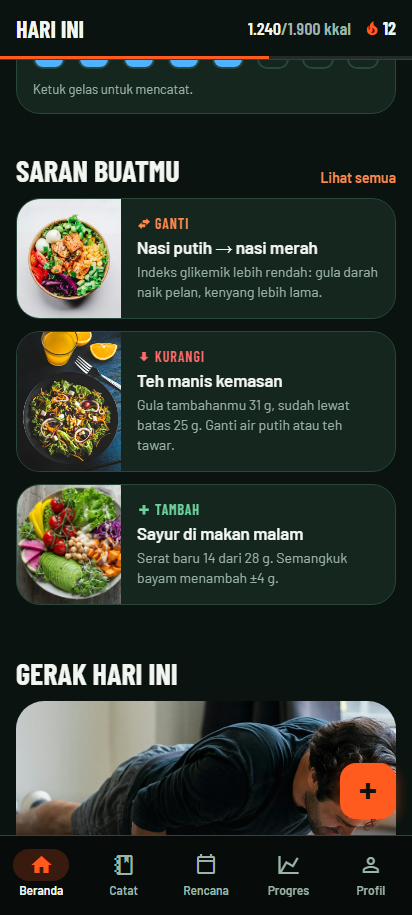
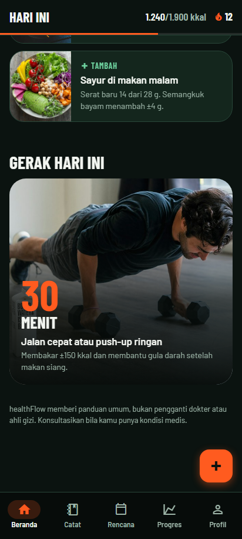

# healthFlow

> Nama sementara, belum nama resmi. Project besar **Lost Boys**.

Aplikasi mobile yang memberi **panduan pola makan sehat dan seimbang** sesuai kondisi dan tujuan masing-masing user.

## Masalah yang diselesaikan

Banyak orang kesulitan menjaga pola makan sehat dan seimbang karena **tidak memahami kebutuhan nutrisi tubuhnya** dan **tidak punya panduan makan** yang sesuai dengan kondisi serta tujuannya.

healthFlow menjawabnya dengan dua hal:

1. **Edukasi:** user paham kebutuhan nutrisinya lewat visualisasi "sekarang vs target".
2. **Panduan personal:** rekomendasi apa yang dikurangi, diganti, atau ditambah, dibantu **reminder** dan **streak** supaya user tetap konsisten.

## Target user

Semua kalangan, **umur 15 tahun (SMA) sampai lansia**. Rekomendasi dipersonalisasi berdasarkan **tujuan + kondisi + aktivitas**, dengan umur sebagai penyesuai:

- **Remaja (15–18):** tidak boleh diberi defisit kalori agresif karena masih masa pertumbuhan.
- **Lansia:** fokus pada protein, kalsium, dan vitamin D. Tampilan harus mudah dibaca.

## Screenshot

Prototipe UI layar **Beranda** (web preview, ukuran HP 412×915). Semua data di layar ini masih **data contoh**.

| Hero & cincin kalori | Makro & makan berikutnya | Streak & air minum |
|:---:|:---:|:---:|
|  |  |  |

| Saran makanan | Gerak hari ini |
|:---:|:---:|
|  |  |

**Animasi yang sudah ada:**

- Foto hero bergerak parallax dan membesar saat layar ditarik ke bawah.
- Isi hero memudar saat discroll, lalu header lengket muncul.
- Kartu fade dan naik saat masuk layar (scroll reveal).
- Carousel makro berhenti pas di tiap kartu.
- Tombol "Catat makan" menyusut saat scroll ke bawah.
- Cincin kalori terisi saat app dibuka, dan lingkaran streak hari ini berdenyut.

Semua animasi jalan di UI thread (Reanimated) supaya tetap mulus di HP kelas menengah ke bawah, dan otomatis dimatikan kalau setelan "kurangi gerakan" di HP aktif.

## Fitur

### MVP

| Kelompok | Fitur |
|---|---|
| Profil | Register & login; profil kesehatan (tinggi, berat, umur, target BB, kondisi, aktivitas, preferensi makan) |
| Nutrisi | Kalkulator BMR / TDEE / makro / BMI; database makanan Indonesia; food diary; dashboard nutrisi; rekomendasi + substitusi makanan |
| Makan | Jadwal makan + reminder |
| Monitoring | Pencatat berat badan; pencatat air minum |
| Motivasi | Daily streak; daily goals |
| Pengaturan | Push notification; manajemen akun; privasi |

Kondisi khusus di MVP: **diabetes** dan **hipertensi**.

### Versi 1.1

Weekly meal planner, resep sehat, daftar belanja, riwayat dan laporan progres, achievement dan badges, weekly goals, artikel dan tips kesehatan, dark mode, bahasa, export data, dan barcode scanner.

### Versi 2

AI nutrition assistant, AI food scanner, smart meal planning, challenge, komunitas, share progress, konten ahli gizi, dan sleep/activity tracker.

### Navigasi (5 tab)

| Tab | Isi |
|---|---|
| Beranda | Dashboard hari ini, makan berikutnya, streak, air minum, saran |
| Catat | Food diary, cari makanan |
| Rencana | Jadwal makan, meal plan, resep, daftar belanja |
| Progres | Berat badan, BMI, riwayat, badges |
| Profil | Profil kesehatan, pengaturan |

## Tech stack

| Bagian | Teknologi |
|---|---|
| Mobile | React Native + **Expo SDK 58**, TypeScript, Expo Router |
| Styling | **NativeWind 4** (Tailwind CSS 3) |
| Performa | FlashList, Reanimated, expo-image |
| Data lokal | expo-sqlite + MMKV (offline-first) *(rencana)* |
| Notifikasi | expo-notifications *(rencana)* |
| Backend | Java + **Spring Boot** *(rencana)* |
| Database | **PostgreSQL** *(rencana)* |

Fokus platform: **Android dulu**. iOS ikut dari kode yang sama.

## Desain

Palet 3 warna dengan aturan **60 / 30 / 10**:

| Porsi | Warna | Dipakai untuk |
|---|---|---|
| 60% | `#0B1310` hitam kehijauan | latar |
| 30% | `#14261D` hijau tua | kartu dan permukaan |
| 10% | `#FF5B1F` oranye | progres "sekarang" dan aksi utama |

Font: **Barlow Condensed** untuk judul dan angka, **Barlow** untuk teks. Token warna ada di `frontend/tailwind.config.js` dan `frontend/src/theme/tokens.ts`.

## Menjalankan aplikasi

Butuh Node.js 20+.

```bash
cd frontend
npm install
npx expo start          # lalu tekan "w" untuk web, atau scan QR dengan Expo Go
npx expo start --web    # langsung buka di browser
```

Cek kualitas kode sebelum commit:

```bash
npx tsc --noEmit    # typecheck
npx eslint src      # lint
```

## Struktur folder

```
healthFlow/
├── PRODUCT.md              # ringkasan produk (user, tujuan, prinsip)
├── docs/screenshots/       # screenshot aplikasi
├── frontend/               # aplikasi mobile (Expo)
│   └── src/
│       ├── app/            # layar (Expo Router)
│       │   └── (tabs)/     # 5 tab navigasi
│       ├── components/     # komponen UI
│       ├── data/           # data contoh (sementara)
│       └── theme/          # token warna
└── backend/                # Spring Boot (belum dibuat)
```

## Tim

Lost Boys: 4 orang (3 tech, 1 PM).

## Disclaimer

healthFlow memberi panduan umum dan **bukan pengganti dokter atau ahli gizi**. User dengan kondisi medis disarankan berkonsultasi dengan tenaga kesehatan.
